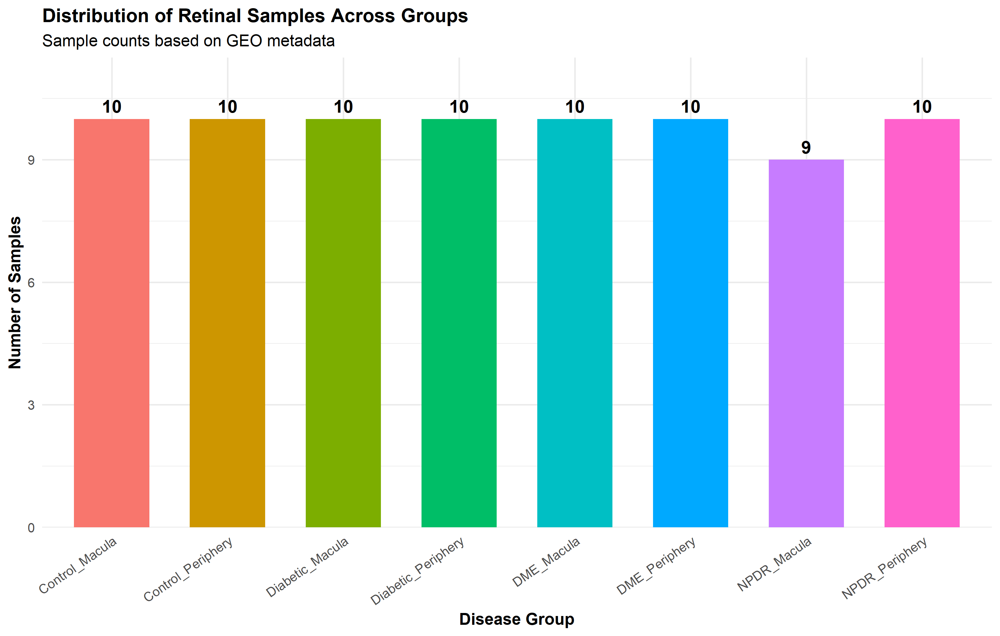
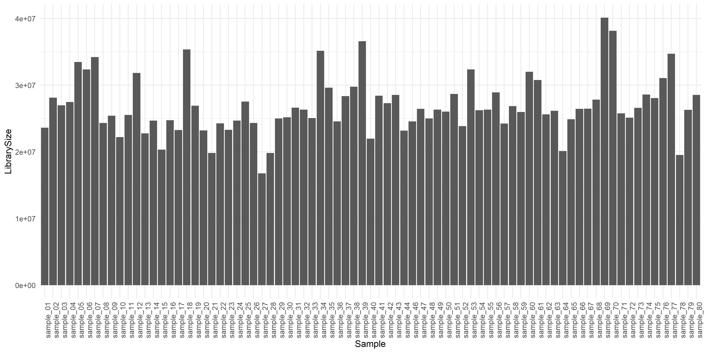
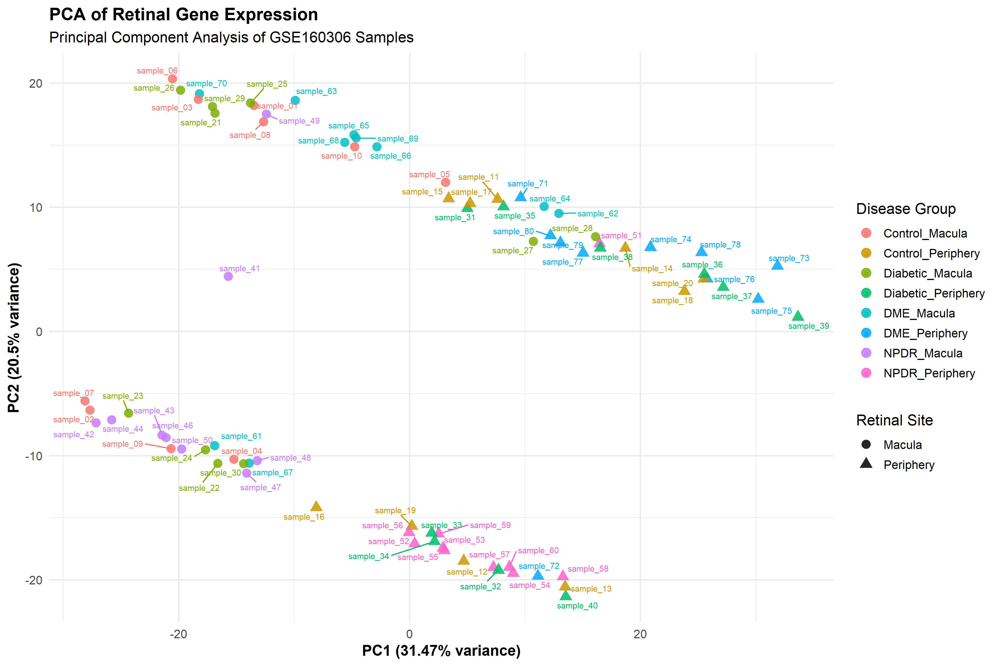
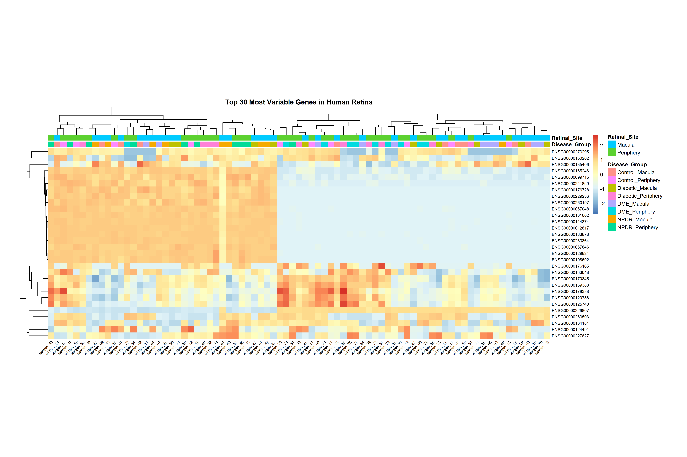
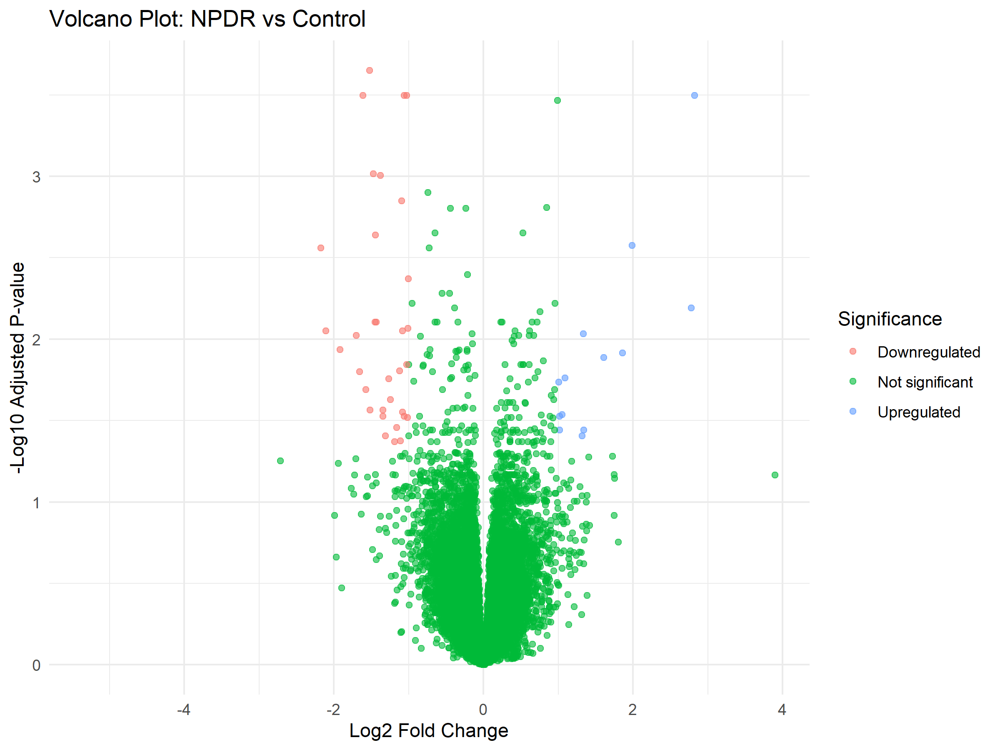

# Transcriptomic Analysis of Human Diabetic Retinopathy (GSE160306)

This repository contains the complete bioinformatics analysis, data processing pipelines, visualizations, and report investigating gene expression changes across different stages of Diabetic Retinopathy (DR) using the human post-mortem retinal RNA-seq dataset **GSE160306**.

---

## Deliverables & Rendered Outputs
- **Rendered PDF Report:** [report/diabetic_retinopathy_transcriptomics_report.pdf](report/diabetic_retinopathy_transcriptomics_report.pdf)
- **Rendered HTML Report:** [report/diabetic_retinopathy_transcriptomics_report.html](report/diabetic_retinopathy_transcriptomics_report.html)
- **Quarto Source Notebook:** [report/diabetic_retinopathy_transcriptomics_report.qmd](report/diabetic_retinopathy_transcriptomics_report.qmd)
- **Code Directory:** [code/](code/) (Scripts `01` through `09` and visualization routines)
- **Results Directory:** [results/plots/](results/plots/) and [results/tables/](results/tables/)

---

## 1. Dataset Exploration Summary

| Metric | Output Value | Description |
|:---|:---:|:---|
| **Total Ensembl Gene IDs** | 58,051 | Complete human gene transcript inventory |
| **Total Biological Samples** | 79 | Human donor retinal punch biopsies |
| **Total Data Matrix Columns** | 80 | Gene ID column + 79 sample count columns |
| **Missing Values (NA)** | 0 | Complete count matrix with no missing entries |
| **Duplicate Gene IDs** | 0 | Verified unique Ensembl identifiers |
| **Minimum Count** | 0 | Baseline unexpressed state |
| **Maximum Count** | 2,983,141 | Highly abundant structural/mitochondrial reads |
| **Filtered Expressed Genes** | 27,457 | Retained with $\ge 10$ counts in $\ge 2$ samples |

> **Explanation:** The imported raw count matrix from GSE160306 contains 58,051 Ensembl gene features across 79 post-mortem retinal punch biopsies. Quality checks confirmed zero missing entries and zero duplicate IDs. Low-expression filtering retained 27,457 informative genes for statistical modeling.

---

## 2. Sample Distribution Across Disease Stages and Retinal Sites

| Disease Group | Retinal Site | Sample Count ($n$) |
|:---|:---|:---:|
| Control | Macula | 10 |
| Control | Periphery | 10 |
| Diabetic (no retinopathy) | Macula | 10 |
| Diabetic (no retinopathy) | Periphery | 10 |
| DME / PDR | Macula | 10 |
| DME / PDR | Periphery | 10 |
| NPDR | Macula | 9 |
| NPDR | Periphery | 10 |
| **Total Retinal Samples** | **All Groups** | **79** |

> **Explanation:** The 79 samples from 43 donor eyes are evenly balanced across disease stages and anatomical sites (10 samples per group, except NPDR Macula with 9 samples), providing balanced statistical power for comparisons between macular and peripheral retinas.

---

## 3. Sequencing Depth and Library Size Quality Control

> **Explanation:** Mapped sequencing depths range from 16.7 million to 40.1 million reads per sample, with an average library size of 26.4 million reads. The uniform distribution confirms consistent sequencing depth across all 79 libraries with no technical dropouts.

---

## 4. Principal Component Analysis (PCA)

> **Explanation:** Unsupervised PCA on VST-transformed data captures 51.97% of total variance (PC1 = 31.47%, PC2 = 20.50%). Samples separate primarily by anatomical location (circles = Macula, triangles = Periphery) and donor biological sex (quadrant clusters), with secondary separation along the disease progression axis.

---

## 5. Top 30 Most Variable Genes and Expression Heatmap

| Ensembl ID | Associated Gene | Chromosome | Variance | Primary Biological Function |
|:---|:---|:---:|:---:|:---|
| `ENSG00000229807` | *AL031777.1* | Chr 14 | 23.08 | Long non-coding RNA regulatory transcript |
| `ENSG00000114374` | *USP9Y* | Chr Y | 18.82 | Male-specific ubiquitin peptidase 9 |
| `ENSG00000012817` | *KCNQ1* | Chr 11 | 17.15 | Voltage-gated potassium channel subunit |
| `ENSG00000183878` | *UTY* | Chr Y | 15.81 | Histone demethylase UTY (male-specific) |
| `ENSG00000067048` | *DDX3Y* | Chr Y | 15.75 | DEAD-box helicase 3 Y-linked |
| `ENSG00000131002` | *CYP1A1* | Chr 15 | 13.69 | Cytochrome P450 monooxygenase |
| `ENSG00000129824` | *RPS4Y1* | Chr Y | 11.69 | Ribosomal protein S4 Y-linked |
| `ENSG00000233864` | *TTTY15* | Chr Y | 10.50 | Testis-specific transcript Y-linked (lncRNA) |
| `ENSG00000067646` | *ZFY* | Chr Y | 8.23 | Zinc finger protein Y-linked |
| `ENSG00000165246` | *NLGN4Y* | Chr Y | 7.49 | Neuroligin 4 Y-linked cell adhesion |
| `ENSG00000198692` | *EIF1AY* | Chr Y | 5.92 | Translation initiation factor 1A Y-linked |
| `ENSG00000099715` | *COL1A1* | Chr 17 | 5.92 | Collagen type I alpha 1 structural fibril |
| `ENSG00000120738` | *EGR1* | Chr 5 | 4.52 | Early growth response 1 transcription factor |
| `ENSG00000170345` | *FOS* | Chr 14 | 4.50 | c-Fos proto-oncogene (AP-1 complex) |
| `ENSG00000135406` | *FOSB* | Chr 19 | 4.48 | AP-1 transcription factor subunit |

> **Explanation:** Hierarchical clustering reveals that primary cohort variance is driven by Y-linked genes (*UTY*, *DDX3Y*, *RPS4Y1*, *ZFY*, *NLGN4Y*) that separate male from female donors, followed by anatomical differences between macular and peripheral tissues and immediate-early stress genes (*FOS*, *EGR1*).

---

## 6. Differential Gene Expression: NPDR vs. Healthy Control

| Ensembl ID | Symbol | Base Mean | $\log_2\text{FC}$ | Wald Stat | Adjusted $p$ (FDR) | Expression Trend & Biological Note |
|:---|:---|:---:|:---:|:---:|:---|
| `ENSG00000130300` | *PLA2G4C* | 6.53 | **+2.83** | +5.48 | $3.18 \times 10^{-4}$ | Upregulated; phospholipase A2 inflammatory response |
| `ENSG00000172482` | *SLC38A11* | 7.15 | **+2.78** | +4.51 | $6.44 \times 10^{-3}$ | Upregulated; amino acid membrane transporter |
| `ENSG00000254781` | *AL137145.1* | 9.86 | **+1.99** | +4.79 | $2.66 \times 10^{-3}$ | Upregulated; long non-coding RNA |
| `ENSG00000157766` | *ACACB* | 13.88 | **+1.86** | +4.19 | $1.22 \times 10^{-2}$ | Upregulated; fatty acid biosynthesis |
| `ENSG00000234816` | *AC008770.2* | 12.97 | **+1.61** | +4.16 | $1.30 \times 10^{-2}$ | Upregulated; regulatory lncRNA |
| `ENSG00000228065` | *AL354720.1* | 85.04 | **+1.34** | +3.71 | $3.63 \times 10^{-2}$ | Upregulated; non-coding transcript |
| `ENSG00000215572` | *AC010970.1* | 5.63 | **-1.52** | -5.76 | $2.23 \times 10^{-4}$ | Downregulated; non-coding RNA |
| `ENSG00000143248` | *RGS5* | 586.28 | **-1.03** | -5.53 | $3.18 \times 10^{-4}$ | **Downregulated; pericyte marker reflecting pericyte loss** |
| `ENSG00000187513` | *GDF7* | 17.57 | **-1.06** | -5.46 | $3.18 \times 10^{-4}$ | Downregulated; growth differentiation factor 7 |
| `ENSG00000158859` | *ADAMTS4* | 182.25 | **-1.61** | -5.42 | $3.18 \times 10^{-4}$ | **Downregulated; ECM proteoglycan degradation metallopeptidase** |
| `ENSG00000164379` | *BBOX1* | 6.94 | **-1.38** | -5.13 | $9.89 \times 10^{-4}$ | Downregulated; gamma-butyrobetaine hydroxylase |
| `ENSG00000197815` | *RGL3* | 5.52 | **-2.18** | -4.76 | $2.76 \times 10^{-3}$ | Downregulated; Ral guanine nucleotide dissociator |
| `ENSG00000175592` | *PRSS56* | 11.32 | **-2.11** | -4.35 | $8.91 \times 10^{-3}$ | Downregulated; serine protease 56 |
| `ENSG00000122641` | *INHBA* | 255.33 | **-1.92** | -4.23 | $1.16 \times 10^{-2}$ | **Downregulated; Inhibin beta A (Activin A) TGF-beta signaling** |
| `ENSG00000151617` | *EDNRA* | 10.66 | **-1.08** | -4.35 | $8.91 \times 10^{-3}$ | **Downregulated; endothelin receptor A vascular tone regulator** |
| `ENSG00000163638` | *ADAMTS9* | 242.48 | **-1.16** | -3.73 | $3.49 \times 10^{-2}$ | **Downregulated; anti-angiogenic matrix metallopeptidase** |
| `ENSG00000138061` | *CYP1B1* | 89.48 | **-1.01** | -3.80 | $3.04 \times 10^{-2}$ | Downregulated; cytochrome P450 1B1 capillary regulator |
| `ENSG00000206384` | *COL6A6* | 5.70 | **-1.52** | -3.84 | $2.72 \times 10^{-2}$ | **Downregulated; collagen type VI alpha 6 basement anchor** |

> **Explanation:** Testing NPDR against Control identified 46 statistically significant DEGs ($\text{padj} < 0.05$, $|\log_2\text{FC}| > 1.0$), with 10 upregulated and 36 downregulated genes. The downregulated set is enriched for markers of pericyte loss (*RGS5*), basement membrane disassembly (*ADAMTS4*, *ADAMTS9*, *COL6A6*), and impaired vasoactivity (*EDNRA*, *INHBA*).

---

## 7. Gene Ontology (GO) Biological Process Enrichment Analysis

| GO Term ID | Enriched Biological Process Description | Gene Ratio | Bg Ratio | Fold Enrichment | Adjusted $p$ (FDR) | Associated Genes |
|:---|:---|:---:|:---:|:---:|:---:|:---|
| `GO:0071372` | Cellular response to follicle-stimulating hormone stimulus | 2/24 | 10/18842 | 157.02 | **0.0375** | *INHBA*, *EDNRA* |
| `GO:0032354` | Response to follicle-stimulating hormone | 2/24 | 14/18842 | 112.15 | **0.0375** | *INHBA*, *EDNRA* |
| `GO:0071371` | Cellular response to gonadotropin stimulus | 2/24 | 17/18842 | 92.36 | **0.0375** | *INHBA*, *EDNRA* |
| `GO:0003228` | Atrial cardiac muscle tissue development | 2/24 | 19/18842 | 82.64 | **0.0375** | *TBX18*, *EDNRA* |
| `GO:0030198` | **Extracellular matrix organization** | 4/24 | 278/18842 | **11.30** | **0.0375** | *CYP1B1*, *ADAMTS4*, *ADAMTS9*, *COL6A6* |
| `GO:0043062` | **Extracellular structure organization** | 4/24 | 279/18842 | **11.26** | **0.0375** | *CYP1B1*, *ADAMTS4*, *ADAMTS9*, *COL6A6* |
| `GO:0045229` | **External encapsulating structure organization** | 4/24 | 280/18842 | **11.22** | **0.0375** | *CYP1B1*, *ADAMTS4*, *ADAMTS9*, *COL6A6* |
| `GO:0034698` | Response to gonadotropin | 2/24 | 24/18842 | 65.42 | **0.0375** | *INHBA*, *EDNRA* |

> **Explanation:** Over-representation analysis identified 8 statistically significant GO Biological Process terms ($\text{padj} < 0.05$). The terms converge on extracellular matrix organization (`GO:0030198`) and peptide hormone/vasoactive signaling, highlighting basement membrane remodeling in early NPDR.

---

## 8. Conclusions

This study delivers a comprehensive comparative transcriptomic evaluation of human diabetic retinopathy utilizing the post-mortem retinal dataset GSE160306. By applying robust preprocessing, variance stabilization, and negative binomial modeling, we identified 46 statistically significant differentially expressed genes that characterize the transition from healthy retina to non-proliferative diabetic retinopathy. Our findings provide compelling transcriptomic evidence for the loss of pericyte identity markers (*RGS5*), degradation of extracellular matrix structural integrity (*ADAMTS4*, *ADAMTS9*, *COL6A6*, *CYP1B1*), and impaired vasoactive receptor networks (*EDNRA*, *INHBA*). Furthermore, multidimensional ordination established that anatomical topography and biological sex constitute major determinants of retinal transcriptomic variance, establishing the imperative for spatially stratified experimental designs in ocular bioinformatics. These identified genes and pathways illuminate the molecular pathophysiology of early diabetic retinopathy and present promising candidate biomarkers and therapeutic targets for early clinical intervention prior to irreversible vision loss.
